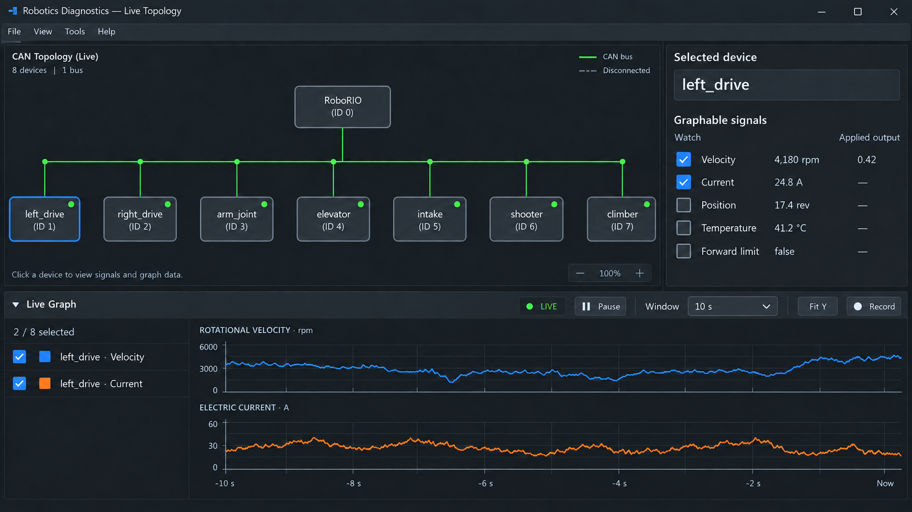
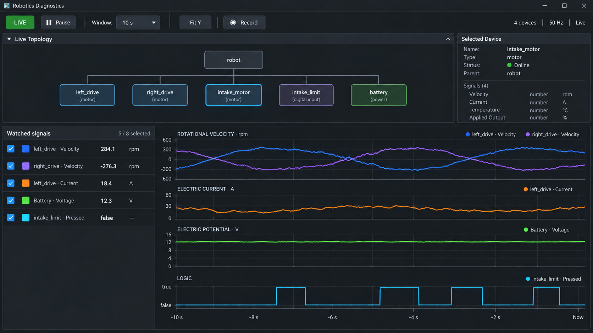
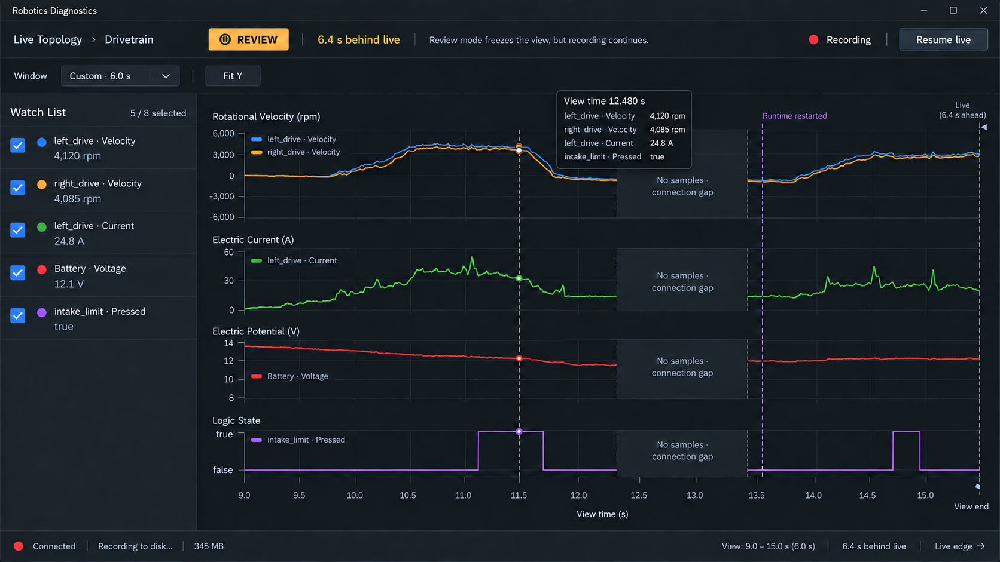

SPEC_STATUS: NOT_IMPLEMENTED

# Feature Spec: Signal History, Live Graphing, and Capture

## Purpose

Define one timestamped signal-history system for live UI2 graphs, robot-side diagnostic summaries, and portable capture files.

The feature extends the existing robot sampler. It does not add a second telemetry reader, and it does not use NetworkTables.

## Status

This spec defines approved target behavior. No graphing or capture implementation exists yet.

The user approved the Live Topology graph pane, the selected-device signal picker, and the graph time controls described in this spec. Update `Current UI And Runtime Rules - V2.md` before or with the implementation. Do not update the runtime-rules document before implementation begins.

## Decision summary

The system will use separate contracts for live transport and persistence.

```text
device wrapper
    -> SampledTelemetrySampler
    -> typed accepted sample
       -> rolling diagnostic summaries
       -> bounded robot history
       -> REST history pages
       -> optional capture sink

REST history pages
    -> shared host history store
       -> UI2 live graph
       -> optional host capture/export
```

The architectural decisions are:

- REST remains the live robot-to-host transport.
- NetworkTables is not part of graphing, history, capture, or export.
- `SampledTelemetrySampler` remains the sole owner of robot-side vendor reads.
- A format-neutral signal model owns identity, type, unit, provenance, timestamps, quality, and gaps.
- `/runtime/state` remains a current-state endpoint. It will not carry sample arrays.
- UI2 graphing lives inside the existing Live Topology work surface.
- WPILOG is the first persistent format for robot-local samples.
- MCAP is an optional host-side format for Foxglove and multi-source diagnostic sessions.
- CSV is an export. Parquet is deferred until an analytical workflow requires it.
- JSON is the REST wire format and may be used for fixtures. It is not the canonical capture format.

## Problem

The current UI shows current values but does not show how values changed over time. That makes timing and cause-and-effect failures difficult to diagnose.

Useful comparisons include:

```text
armMotor.output_percent_cmd
armMotor.velocity_actual
armMotor.current_actual
armLimit.pressed
```

The robot already samples timestamped current values. `SampledTelemetrySampler` keeps those samples private and publishes only aggregate values such as instant, average, peak, and sample count. `/runtime/state` then exposes a cached current snapshot. Host polling cannot reconstruct the original sample history from that snapshot.

The missing capability is a bounded, typed history contract that preserves samples after the existing sampler accepts them.

## Goals

- Show several related signals on one shared time axis.
- Preserve real robot sample timestamps.
- Keep several seconds of bounded history before the operator opens or pauses a graph.
- Support numeric and boolean signals.
- Make missing data, resets, and overwritten history visible.
- Keep live acquisition independent of graph rendering and pause state.
- Save robot-local samples in a format that AdvantageScope can open.
- Allow later MCAP capture without changing the sampler or REST domain contract.
- Allow later DSL annotations without making graphing depend on the DSL.
- Keep robot-local data and PC passive-CAN data distinct by source and clock.

## Non-goals

- Do not add a top-level Graphs tab.
- Do not use NetworkTables for transport, discovery, or compatibility publication.
- Do not poll `/runtime/state` faster to synthesize history.
- Do not make the DSL signal registry the graph catalog.
- Do not trigger vendor reads from REST requests or graph rendering.
- Do not decode arbitrary passive CAN payloads as robot-local engineering values.
- Do not require AdvantageKit.
- Do not make MCAP a roboRIO dependency.
- Do not make CSV, Parquet, screenshots, or saved REST responses the canonical capture.
- Do not promise exact robot-to-PC clock alignment in the first release.

## Existing system

### Robot sampling

Purpose: identify the source that the feature must extend.

`Robot.robotPeriodic()` calls `BringupRuntime.sampleTelemetry(...)` on the robot loop. `BringupRuntime` applies a bounded read budget and passes active, created devices to `SampledTelemetrySampler`.

The sampler:

- reads registered device signals in round-robin order
- records a timestamp and a `double` value
- retains a short per-signal deque
- computes rolling summaries
- removes history when a registration leaves the active runtime set

Current sampled registrations cover motor current. Point-in-time snapshots also contain values such as command, applied duty, velocity, position, voltage, and temperature, but those snapshot reads are not timestamped history.

### Current REST path

Purpose: separate current-state delivery from sample-history delivery.

`/runtime/state` returns a full runtime snapshot. The robot caches device rows for one second, and UI2 normally polls at a much lower rate than the robot loop.

`/runtime/state` answers:

> What is the current runtime state?

The new history contract answers:

> Which accepted samples occurred after this cursor?

These contracts must remain separate.

### Existing host history

Purpose: identify reusable patterns without treating them as signal history.

The host already has bounded timestamp collections for passive CAN frames and rate calculations. Those collections contain raw frames or frame times, not decoded engineering values.

The REST log endpoint already uses sequence-based incremental reads. Its cursor behavior is a useful precedent, but log strings are not the signal-history model.

## Operator workflow

### Live Topology integration

Purpose: place graphing in the current UI without adding another top-level mode.

Live Topology will remain the primary work surface. The selected-device inspector will list live values and graphable signals. A collapsible, vertically resizable graph pane will occupy the bottom of the Live Topology work area.

The graph pane will share the topology selection context but will own a separate watch list. Selecting another device changes the signal picker. It does not clear watched traces.

The initial workflow is:

1. Select a device in Live Topology.
2. Review the device's current values and graphable signals.
3. Check one or more signals to add them to the watch list.
4. Use the graph pane, which opens when the first signal is checked.
5. Pause, pan, zoom, or inspect values with the cursor.
6. Resume to return to the live edge.

The first release adds signals only from the selected-device inspector. It does not add a right-click `Watch signals` command. This keeps the existing right-click manual-duty workflow unchanged. A later UI review may add a watch command after operators have used the inspector workflow.

### Signal picker

Purpose: make signal selection direct and keep it separate from topology selection.

The selected-device inspector must contain a **Graphable signals** section. The section must show only catalog descriptors for the selected device that have `graphable=true`.

Each signal row must show:

- a **Watch** checkbox
- the signal display name
- the latest accepted value
- the canonical unit
- the current quality state
- the assigned trace color when the signal is watched

The **Watch** control must use the same standard checkbox-row pattern as the existing **Active Group** device list. It must not use a pill, icon-only toggle, or custom switch. Checking the box adds the signal to the watch list and graph. Clearing the box removes the signal and makes its retained host history eligible for release. The first checked signal opens the graph pane automatically.

The first release has no hidden-trace state and no **Select all signals** action. Every checked signal is visible. Every unchecked signal is absent from the graph.

Changing the selected topology device must change only the rows in **Graphable signals**. It must not remove, hide, or replace existing watched signals. If two watched signals have the same display name, the graph must qualify both names with the device label.

The signal picker must not expose axis or lane controls. The graph model assigns a signal to the lane for its engineering dimension. Signals from different devices share a lane only when their engineering dimensions match.

The graph model must enforce the signal and lane limits before selection. When eight signals are checked, it must disable every additional unchecked signal and show `8 graph signals maximum. Remove a signal first.` When four lanes exist, it must disable only unchecked signals that would introduce a fifth engineering dimension. It must show `4 engineering-dimension lanes maximum. Remove a signal from another lane first.` Signals that use an existing lane remain available until eight signals are checked.

### Watch list

Purpose: keep graph membership visible while topology selection changes.

The graph pane must contain a persistent watch list. Each row must show:

- a standard checked checkbox
- the trace color
- the device label and signal display name
- the latest accepted value and unit
- the quality or stale state

The checkbox in the watch list and the matching checkbox in the selected-device inspector represent the same state. Clearing either checkbox removes the signal from both locations. Removing a signal permits the host history store to release its retained samples unless an active capture or another host consumer still needs them.

The watch list must show the current count as `n / 8 selected`. Trace colors must remain stable while a signal stays on the watch list. Device-selection changes and lane reordering must not assign a new color.

The watch list lasts for the current UI2 process only. Closing and reopening UI2 starts with an empty watch list. Saved watch presets are deferred.

The graph pane must use this control hierarchy:

```text
graph toolbar
  viewport state | pause or resume | time-window dropdown | Fit Y | Record
graph content
  persistent watch-list column | aligned graph lanes
```

The watch-list column may resize with the graph pane, but the operator must not need to return to a previously selected device to remove one of its signals. The graph lane labels must repeat the trace colors and signal names so that a narrow watch-list column does not make traces anonymous.

Collapsing the graph pane must not change the watch list, ingestion, retention, capture state, selected time window, or viewport state. Reopening the pane restores the same session state.

### Time window and live state

Purpose: make the displayed time range predictable without changing acquisition.

The graph toolbar must provide a non-editable time-window dropdown with these choices:

- **2 s**
- **5 s**
- **10 s**
- **30 s**
- **60 s**

The default is **10 s**. A dropdown selection changes only the horizontal viewport. It must not change the robot sampling cadence, REST polling cadence, host retention, pre-trigger retention, or capture duration.

The graph has two viewport states:

- `LIVE` keeps the right edge attached to the newest projected sample time.
- `REVIEW` freezes the viewport bounds while acquisition, REST ingestion, host retention, and capture continue.

In `LIVE`, selecting a dropdown value shows that duration ending at the live edge. In `REVIEW`, selecting a dropdown value changes the duration but keeps the current viewport center fixed when retained history permits it. A time-window selection must not return the graph to `LIVE`.

Selecting **Pause**, panning, or zooming changes the viewport to `REVIEW`. The graph must show `REVIEW` and the distance between the frozen right edge and the live edge. It must also show a **Resume live** action. Returning the pan position to the newest data must not resume live scrolling implicitly.

Selecting **Resume live** changes the viewport to `LIVE` and moves its right edge to the newest sample. The action keeps the current viewport duration. After free zoom, the closed dropdown must show `Custom · <duration>`. The custom value is a status display, not an editable choice.

Free zoom must clamp the viewport duration to at least 1 second and at most the retained host-history duration. Panning must clamp the viewport to retained history. When eviction removes data under a frozen viewport, the graph must show the resulting gap and move only the unavailable boundary. It must not resume live scrolling.

In `LIVE`, the horizontal axis uses time relative to the live edge and ends at `Now`. In `REVIEW`, the axis uses frozen source-session times and ends at `View end`. The toolbar reports how far `View end` is behind the live edge. Cursor details must include the original source timestamp and the projected session time.

### Vertical scale and cursor

Purpose: keep unlike units separate and make inspected values honest.

The graph model must create one aligned lane for each visible engineering dimension. It must place signals with the same dimension on the same vertical scale. It must not place signals with different dimensions on one vertical scale.

Each lane autoscales from the visible samples in that lane and includes padding around the minimum and maximum. Boolean lanes use fixed `false` and `true` levels. The **Fit Y** action recomputes every numeric lane from the current viewport. Manual vertical zoom changes only the selected lane and remains in effect until the operator selects **Fit Y** or changes the visible membership of that lane.

The shared vertical cursor must cross all aligned lanes. For each visible trace, the cursor readout must show the nearest accepted source sample, its unit, its quality, and its source timestamp. The cursor must not present an interpolated value as a recorded sample. If no sample is valid at the cursor because of a gap or lifecycle boundary, the readout must show `No sample`.

### Graph behavior

Purpose: define the first useful graph interaction contract.

The graph must support:

- multiple watched traces
- add and remove signal actions
- live scrolling
- pause and resume
- pan and zoom
- a time cursor with exact source values
- automatic range selection
- visible history gaps
- numeric line traces
- boolean step traces
- a common time axis across all visible lanes

Signals with the same engineering dimension must share a lane and scale. Signals with different dimensions must use separate aligned lanes. The graph must not imply that amperes, revolutions per minute, volts, and boolean state share one numeric scale.

Pause freezes the visible viewport as `REVIEW`. Sampling, REST ingestion, host retention, and active capture continue.

The renderer must request a decimated view based on the visible time range and pixel width. Decimation must preserve extrema. Rendering must not delete or rewrite retained source samples.

The first release supports at most eight checked traces grouped into at most four aligned lanes. The signal picker disables choices that would exceed either limit and explains why.

### Approval mockups

Purpose: show the required control hierarchy and operator states before implementation.

The user approved the mockup layout and accepted the default decisions for all remaining UI questions. The mockups are design examples, not screenshots of implemented behavior. Approval covers the placement, hierarchy, named controls, and state transitions described below. It does not require pixel-for-pixel reproduction of colors, fonts, spacing, topology contents, or sample values. The written requirements in this spec control if an image and the text disagree.

#### Mockup A: select signals



This mockup demonstrates these requirements:

- the selected-device inspector contains **Graphable signals**
- each graphable signal has a **Watch** checkbox, a value, and a unit
- selecting a checkbox adds a visible trace
- the graph pane remains inside Live Topology
- the toolbar exposes the live state, time-window dropdown, **Fit Y**, and **Record**
- the watch list and graph lanes appear together in the graph pane

#### Mockup B: compare devices live



This mockup demonstrates these requirements:

- the watch list keeps signals from several devices
- changing topology selection does not clear watched signals
- five visible traces fit within the eight-trace limit
- four engineering dimensions use four aligned lanes
- signals with the same dimension share one lane and one vertical scale
- the common time axis ends at `Now` in `LIVE`

#### Mockup C: review a fault



This mockup demonstrates these requirements:

- pause, pan, or zoom changes the viewport to `REVIEW`
- the toolbar reports how far the frozen view is behind live data
- **Resume live** is explicit
- recording and ingestion continue during review
- the shared cursor crosses every lane and reports source values
- connection gaps and runtime boundaries remain visible
- a custom time window reports its exact duration
- the frozen axis ends at `View end` instead of `Now`

### Runtime transitions

Purpose: keep history behavior clear when runtime ownership changes.

When runtime deactivates:

- the robot ends the current history generation
- the host retains already received samples within its own bounded history
- watched signals remain selected but show unavailable or stale state
- the graph inserts a lifecycle boundary or visible gap

When runtime activates again, the robot starts a new history generation. The host must not join the two generations as one continuous trace.

## Signal domain model

### Descriptor

Purpose: define graphable signals without making them DSL signals.

Each graphable signal has a descriptor with these fields:

```text
signalDefinitionKey
signalId
sourceKind
sourceInstanceId
subjectKey
deviceLabel
signalName
valueKind
unit
engineeringDimension
samplingPolicy
nominalCadence
staleAfter
graphable
```

`signalDefinitionKey` is stable across robot boots and supports saved watch presets. `signalId` includes the source instance and identifies one concrete stream during one history generation.

Initial value kinds are:

- `NUMBER`
- `BOOLEAN`

Initial source kinds are:

- `ROBOT_LOCAL`
- `PC_PASSIVE_CAN`
- `HOST_INTERNAL`

Source kind is required. A passive-CAN-derived value must not reuse a robot-local identity even when both values describe the same physical device.

The DSL may refer to the same canonical signal names later. The DSL registry does not own descriptors, sampling, units, timestamps, or graphability.

The first catalog uses these SI-aligned and FRC-native dimensions and units:

| Dimension key | Canonical unit | Symbol | Stored value |
| --- | --- | --- | --- |
| `ELECTRIC_POTENTIAL` | volts | `V` | numeric volts |
| `ELECTRIC_CURRENT` | amperes | `A` | numeric amperes |
| `ROTATIONAL_VELOCITY` | revolutions per minute | `rpm` | numeric revolutions per minute |
| `LINEAR_VELOCITY` | meters per second | `m/s` | numeric meters per second |
| `ROTATIONAL_POSITION` | revolutions | `rev` | numeric revolutions |
| `TEMPERATURE` | degrees Celsius | `°C` | numeric degrees Celsius |
| `DUTY_CYCLE` | normalized duty ratio | `1` | numeric ratio in `[-1.0, 1.0]` |
| `LOGIC` | boolean | empty string | `true` or `false` |

The UI may display a `DUTY_CYCLE` value as percent by multiplying the stored ratio by 100 and adding `%`. The wire and capture value remains the normalized ratio. This rule avoids treating `0.5` as both 0.5 percent and 50 percent.

Device adapters convert vendor values into these units before the sampler accepts a sample. A new dimension or canonical unit requires an additive catalog-schema update. A unit meaning change requires a new schema version.

### Sample

Purpose: preserve an accepted observation without storage- or transport-specific types.

Each sample contains:

```text
sequence
signalId
sourceTimestamp
value
quality
```

`value` is a typed number or boolean. A missing read is not numeric zero. Failed or unavailable reads either create a quality transition or leave a visible gap according to the signal's sampling policy.

Initial quality values are:

- `GOOD`
- `UNAVAILABLE`
- `READ_ERROR`
- `STALE`

The stored sample keeps the source value. Display formatting and unit conversion happen after ingestion.

### Event and gap

Purpose: represent discontinuities and annotations without fake numeric samples.

History records may also contain:

- a signal declaration
- a clock correlation
- a lifecycle event
- a typed annotation
- a gap

A gap records why a continuous interval is unavailable. Initial reasons include:

- robot ring overwrite
- host queue overflow
- REST disconnect
- source reset
- capture writer overflow

DSL annotations are a later producer of typed events such as test start, phase transition, command change, requirement failure, and test stop. The telemetry service must not ask whether a DSL test is active.

## Robot architecture

### Sampling owner

Purpose: keep one device-read path.

`SampledTelemetrySampler` remains the acquisition owner. Device wrappers continue to supply raw readers through `SampledSignalRegistration`.

Each successful device read produces one accepted sample. That sample feeds:

- the existing rolling aggregate calculation
- the bounded history journal
- any active non-blocking capture sink

REST, UI selection, and capture state must not cause another vendor read.

The sampler will gain descriptor metadata and boolean registrations. It will continue to apply the existing enabled and disabled read budgets. Actual timestamps remain authoritative because the effective cadence decreases as the number of registered signals grows.

### Telemetry journal

Purpose: own ordered history, retention, and cursors behind one interface.

The sampler writes accepted records to a bounded append-only telemetry journal. The journal owns:

- sequence assignment
- declaration-before-sample ordering
- descriptor lookup
- history generations
- time and sample-count retention limits
- cursor paging
- overwrite detection
- explicit gap records
- thread-safe page snapshots
- capture fan-out through bounded queues

Conceptual Java contract:

```java
public interface TelemetryJournal {
  SignalCatalog catalog();

  HistoryPage readAfter(
      HistoryCursor cursor,
      int maxRecords);

  CaptureSubscription subscribe(
      CaptureSelector selector,
      CaptureRecordConsumer consumer);
}
```

The journal must use bounded storage. Every buffer requires both a duration cap and a sample or byte cap. A time limit alone is not a hard memory bound.

The robot journal must use a fixed-capacity structure-of-arrays ring. The hot append path stores sequences, timestamps, signal indexes, value bits, and quality flags in primitive arrays. It must not allocate a `TelemetrySample`, boxed number, list node, or JSON object for each accepted sample. Page construction may allocate after it copies a stable range outside the periodic append path.

The periodic thread is the only robot-local sample writer. REST readers receive immutable page snapshots. Capture sinks consume bounded queues and must never block the robot loop.

The initial robot history limits are:

- 10 seconds of pre-trigger history
- 100,000 records across all signals
- 16 MiB of allocated journal storage

The journal evicts the oldest record when any limit is reached. Constants define all limits. Startup allocates the journal storage once, and runtime resets reuse that storage.

### Signal registrations

Purpose: extend the existing capability instead of reading snapshot or DSL APIs.

`SampledSignalRegistration` will add:

- a stable definition key
- a value kind
- a unit and engineering dimension
- a nominal cadence
- staleness behavior
- whether the signal belongs in history

Device wrappers still own only raw reads and device-specific conversion. They do not own history, graph selection, REST JSON, or file writing.

The first implementation will expose existing sampled motor current. Later increments may register command, applied duty, velocity, position, temperature, voltage, and digital inputs after their vendor-read cost is measured.

## Time model

### Robot source time

Purpose: preserve ordering and intervals across wall-clock adjustments.

Robot-local samples will use an FPGA-backed monotonic timestamp in microseconds. The current `System.currentTimeMillis()` timestamp is not sufficient because wall time can jump.

Each robot history generation also publishes clock-correlation records containing:

- robot monotonic time
- robot wall-clock time
- correlation uncertainty when known

WPILOG maps robot monotonic microseconds directly to its record timestamp.

### Host and passive-CAN time

Purpose: prevent false precision when sources use different clocks.

The host records both the original source timestamp and the host receive timestamp. Passive-CAN frames keep their PC observer timestamp and observer identity.

The host may project several sources onto one display timeline. The projection must retain the estimated offset and uncertainty. Storage must preserve original source clocks and must not rewrite passive-CAN time as robot time.

The host estimates the robot-to-host mapping with a periodic REST clock probe:

1. Record host monotonic time `hostSendNs` immediately before the request.
2. Record robot monotonic time `robotReplyUs` when the robot builds the response.
3. Record host monotonic time `hostReceiveNs` immediately after the response arrives.
4. Map `robotReplyUs` to the host midpoint between `hostSendNs` and `hostReceiveNs`.
5. Treat half of the round-trip time as the minimum uncertainty for that observation.

While history polling is active, the host collects a clock observation every two seconds. It keeps a 30-second rolling window, rejects high-latency outliers, and estimates offset and drift from the lowest-latency observations. The capture records the chosen mapping, its observation interval, and its uncertainty.

The UI applies these alignment states:

- `ALIGNED`: estimated uncertainty is at most 20 ms
- `APPROXIMATE`: estimated uncertainty is greater than 20 ms and at most 50 ms
- `UNSYNCHRONIZED`: estimated uncertainty is greater than 50 ms or no mapping exists

An approximate overlay shows the uncertainty in the graph legend and cursor. An unsynchronized source uses a separate clock lane, and the UI disables cross-source delta readouts. These states prevent the graph from presenting network timing as exact causal order.

## REST contract

### Catalog endpoint

Purpose: publish descriptors without binding host code to runtime-state rows.

Add:

```text
GET /runtime/telemetry/catalog
```

The response contains:

```text
schemaVersion
historyGenerationId
catalogRevision
clockDescriptor
signals[]
```

The catalog is versioned. The host validates the payload once at the REST boundary and converts it into typed host records.

### History endpoint

Purpose: deliver bounded incremental history without retransmitting whole windows.

Add:

```text
GET /runtime/telemetry/history?after=<sequence>&limit=<count>
```

The response contains:

```text
schemaVersion
historyGenerationId
oldestSequence
nextSequence
hasMore
cursorExpired
robotReplyUs
records[]
```

The endpoint must:

- return retained records only
- return records in sequence order
- enforce a symbolic maximum page size
- timestamp response construction with `robotReplyUs`
- report an expired cursor
- report a changed history generation
- avoid device reads
- avoid aggregate calculation
- fail soft when runtime is inactive

The initial endpoint returns records for all graph-enabled robot signals. The host filters by its watch list. A later subscription or filtered-query contract may reduce traffic if measured load requires it.

### Reconnect behavior

Purpose: make loss visible instead of drawing a false continuous line.

The host retains its last acknowledged sequence. After reconnect:

- if the generation matches and the cursor remains available, paging resumes
- if the cursor expired, the host records a gap and resumes at `oldestSequence`
- if the generation changed, the host records a source-reset boundary and starts from the new generation

Repeated pages are safe. The host deduplicates records by generation and sequence.

## Host architecture

### Shared history store

Purpose: give UI and capture one host-side history owner.

Add a shared host service that owns:

- REST cursor state
- catalog revisions
- typed payload validation
- deduplication
- reconnect and source-reset handling
- bounded host retention
- explicit gaps
- watch selection
- time projection
- viewport queries
- extrema-preserving display decimation
- capture fan-out

The Tk view receives immutable graph frames. It must not poll REST, parse JSON, mutate history deques, or write capture files.

Higher-rate history polling must run outside the Tk thread. Worker-to-UI notification queues must be bounded. The UI may coalesce redraw requests, but the history store remains the source of retained host samples.

### Proposed host modules

Purpose: show ownership without requiring these exact filenames.

```text
tools/common/telemetry/
  models.py
  wire.py
  history.py
  capture.py

tools/can_nt/
  telemetry_rest_client.py
  signal_graph_model.py
  signal_graph_view.py

tools/can_topology/
  live_topology_view.py
```

The shared modules must not import Tk. The graph model owns watch selection, viewport state, lane assignment, and cursor projection. The graph view owns drawing and widget events.

### Rendering engine

Purpose: provide the required graph interactions within the Tk event-loop budget.

The first release will use Matplotlib through `FigureCanvasTkAgg`. `requirements-windows.txt` will pin the supported Matplotlib version.

The live renderer must:

- use one embedded figure for the Live Topology graph pane
- use at most four aligned axes for engineering-dimension lanes
- receive immutable, already decimated graph frames
- keep and update existing `Line2D` objects
- avoid `Axes.clear()` during live updates
- use blitting when the Windows Tk backend supports it
- redraw the full figure only after a layout, pan, zoom, or scale change
- cap each visible trace at two points per horizontal pixel
- cap graph refresh at 20 frames per second
- coalesce pending redraw requests instead of building a frame backlog

The host history store performs extrema-preserving decimation before the Tk thread receives a frame. The Tk thread does not iterate raw history or parse REST payloads.

With eight traces and four lanes, the 95th-percentile live update must complete within 40 ms on the supported Driver Station Windows PC. If a frame exceeds that budget, the UI skips the next scheduled redraw. It does not drop source samples.

## Capture and export

### Format-neutral writer contract

Purpose: keep file formats outside the telemetry model.

Capture sinks consume normalized history records. They do not call device readers and do not consume REST dictionaries.

Conceptual contract:

```text
start(captureMetadata, signalCatalog)
append(captureRecord)
flush()
close()
```

Every sink must preserve:

- signal identity
- source provenance
- value kind
- unit
- original source timestamp
- record order
- clock correlations
- annotations
- gaps

### WPILOG

Purpose: provide the first FRC-native persistent format.

WPILOG is the first robot-local capture format because WPILib already supplies the Java writer API and AdvantageScope opens WPILOG directly.

The mapping is:

- one fixed-type entry per signal
- native numeric and boolean entry types
- explicit microsecond timestamps
- versioned JSON entry metadata for descriptor, unit, source, and clock identity
- reserved typed entries for correlations, annotations, lifecycle events, and gaps

The writer must use background I/O and a bounded queue. Writer failure must not stop sampling, runtime control, or REST history. A queue overflow must create a gap record after the writer recovers.

Robot-local WPILOG is the authoritative persisted record of robot samples that reached the capture sink. A host capture created from REST is authoritative only for records received by the host.

WPILOG capture is off by default. The operator can start or stop capture with a Record toggle. Starting a capture writes the retained 10-second pre-trigger window first, then appends live records. Stopping a capture flushes and closes the file.

The first release also provides two opt-in automatic trigger modes:

- `MATCH_ENABLE` starts capture when Driver Station state changes from disabled to enabled. It stops five seconds after the robot returns to disabled.
- `UNCAUGHT_EXCEPTION` starts a best-effort capture when the robot's top-level runtime boundary records an uncaught exception. It writes the pre-trigger window and records for 30 seconds after the trigger when the process remains alive.

Automatic trigger modes are off by default. The operator enables each mode explicitly. Exception-triggered files have a 60-second cooldown. If a trigger occurs during an active capture, the writer adds an annotation to that capture instead of opening another file.

The initial WPILOG limits are:

- 15 minutes per capture
- 64 MiB per capture file
- 128 MiB of reserved free space on the selected storage device

The writer stops cleanly when it reaches the duration limit, the file limit, or the free-space reserve. The UI reports the stop reason. The UI must show whether the writer selected USB storage or roboRIO internal storage before recording begins.

### MCAP

Purpose: support broader robotics tooling without adding a Java dependency.

MCAP belongs on the Windows host because the official MCAP project provides a Python writer but no official Java writer.

The mapping is:

- one channel per signal
- shared numeric and boolean schemas
- channel metadata for descriptor, unit, subject, source, and clock
- original source time in message data
- projected capture time in MCAP `log_time`
- sequence in the MCAP message sequence field
- separate channels for annotations, correlations, and gaps
- chunking and indexes enabled for long captures

Foxglove can open MCAP. AdvantageScope currently exports MCAP but does not list MCAP as an input format. MCAP therefore complements WPILOG rather than replacing it.

MCAP is not required for the first live-graphing release.

### CSV and Parquet

Purpose: define portable analytical exports without making them capture authorities.

CSV export will use a long form by default:

```text
sourceTime,receiveTime,source,signalId,valueKind,value,quality,sequence
```

Long-form export preserves asynchronous samples and does not invent values between updates. A wide, resampled table may be added later if the export records its resampling rule.

Parquet will use the same logical rows plus descriptor and event tables. Parquet is deferred because `pyarrow` would be a large new Windows dependency and AdvantageScope does not open Parquet.

## Performance and safety

### Initial resource limits

Purpose: define enforceable defaults before implementation begins.

The first release uses these limits:

| Resource | Limit |
| --- | ---: |
| Checked graph signals | 8 |
| Aligned engineering-dimension lanes | 4 |
| Default graph time window | 10 seconds |
| Graph time-window dropdown choices | 2, 5, 10, 30, and 60 seconds |
| Minimum custom graph time window | 1 second |
| Robot pre-trigger duration | 10 seconds |
| Robot journal records | 100,000 total |
| Robot journal memory | 16 MiB |
| Host retention duration | 300 seconds |
| Host history records | 500,000 total |
| Host history memory | 64 MiB |
| Per-signal host records | 100,000 |
| Active REST history polls | 10 per second |
| Records in one REST page | 2,000 |
| Encoded REST history page | 1 MiB |
| Live graph refresh | 20 frames per second |
| Rendered points per trace | 2 per horizontal pixel |

Duration, record-count, and byte limits apply together. The service evicts the oldest eligible data when the first retention limit is reached. The host must use compact numeric arrays or chunked typed storage rather than one Python object per retained sample.

The limits are constants, not UI preferences. A later release may expose lower operator-selected limits. Raising a hard limit requires new robot, network, and Windows performance measurements.

### Robot limits

Purpose: protect the 20 ms control loop.

The implementation must:

- preserve the existing bounded signal-read plan
- perform no network or file I/O on the periodic thread
- use bounded history and writer queues
- avoid per-request hardware reads
- avoid console output in the sampling path
- measure memory and loop time with the maximum supported signal count
- expose actual timestamps rather than claiming a fixed sample rate

History storage must use the fixed primitive-array journal described in this spec. The implementation must not retain one Java object per sample.

After startup, the robot journal append path must allocate no heap objects per accepted sample. Regression measurement must confirm that steady-state graph sampling does not add periodic garbage-collection pressure.

### Network limits

Purpose: keep REST history independent of topology polling.

The implementation must:

- cap page record count and encoded response size
- page until `hasMore` is false without blocking Tk
- back off when disconnected
- poll active history no faster than 10 times per second
- avoid resending descriptors when the catalog revision is unchanged
- record gaps when retained history expires

REST delivery rate, robot sample cadence, host retention, and graph frame rate are separate settings.

### Rendering limits

Purpose: keep the Windows UI responsive.

The implementation must:

- cap redraw rate
- decimate to the current pixel width
- update existing line or lane objects where the renderer supports it
- avoid drawing one primitive for every retained sample while zoomed out
- keep ingestion and capture active while the graph is paused
- prevent a ninth signal from being checked

## Failure behavior

The system must fail soft:

- A device read failure affects that signal, not the robot loop.
- A full robot ring overwrites the oldest records and advances `oldestSequence`.
- An expired REST cursor produces a gap.
- A robot restart produces a new history generation.
- A host disconnect freezes new robot data and shows the disconnect.
- A malformed REST payload is rejected at the host boundary.
- A capture writer failure stops that capture and reports the error without stopping telemetry.
- A slow graph renderer drops redraw requests, not source samples.
- An unsupported value kind remains visible in the catalog but is not graphable.

## DSL relationship

Graphing works when no DSL test is selected or running.

The DSL may later publish typed timeline annotations through an event adapter. Test-derived values such as run-local maxima and deltas must not be presented as stable physical signals unless their descriptor states those semantics.

The DSL registry remains responsible for test-language read, write, clear, and safety rules. The telemetry catalog remains responsible for signal type, unit, source, cadence, timestamps, staleness, and graphability.

## Passive-CAN relationship

Passive CAN remains host-local and read-only.

The first passive-CAN graph signals, if added, should be observer metrics such as frame rate, heartbeat age, bus utilization, or presence state. Decoded engineering values require a decoder with explicit confidence and provenance.

Robot-local samples and passive-CAN samples may appear on one display timeline. Their stored identities, clocks, and evidence claims remain separate.

## API versioning

The catalog and history payloads include `schemaVersion`.

Additive fields do not change the version when old readers can ignore them safely. Rename, removal, meaning changes, or incompatible type changes require a new version.

The host must reject an unsupported major version with a clear status message. It must not guess field meaning.

## Testing plan

### Robot unit tests

Purpose: prove that history does not change sampling or summaries.

Add tests for:

- one vendor read producing both a summary update and one history sample
- numeric and boolean registration
- stable descriptor identity
- ordered sequence assignment
- page limits and `hasMore`
- ring wraparound and expired cursors
- generation reset
- read failures and unavailable values
- unchanged aggregate results
- concurrent REST page reads during periodic appends
- zero per-sample journal allocations after startup
- eviction at the duration, record-count, and byte limits
- capture queue overflow and fail-soft behavior

### REST contract tests

Purpose: lock the Java-to-Python interface.

Add fixtures and tests for:

- catalog parsing
- empty history
- multi-page history
- duplicate page ingestion
- expired cursor gaps
- generation changes
- `robotReplyUs` clock observations
- record-count and encoded-byte page limits
- unsupported schema versions
- malformed sample rejection
- inactive-runtime responses

Cross-language golden fixtures must use the same field names and value-kind rules.

### Host tests

Purpose: prove history ownership and graph behavior without a robot.

Add tests for:

- bounded retention
- sequence deduplication
- explicit gap storage
- watch-list persistence across device selection
- signal-picker checkbox and watch-list synchronization
- empty watch list after UI2 restart
- graph-pane collapse without state or acquisition loss
- automatic graph-pane opening for the first checked signal
- disabled checkbox behavior at the signal and lane limits
- stable trace colors across device-selection and lane changes
- pause without acquisition pause
- automatic `REVIEW` entry after pause, pan, or zoom
- explicit live return with the current viewport duration
- dropdown and custom time-window behavior
- viewport clamping to retained history
- per-lane autoscale, manual vertical scale, and **Fit Y** behavior
- cursor values without invented interpolation
- source-reset boundaries
- lane grouping by engineering dimension
- eight-trace and four-lane rejection behavior
- boolean step projection
- extrema-preserving decimation
- clock projection and the aligned, approximate, and unsynchronized thresholds
- global, per-signal, duration, and byte retention limits
- bounded worker-to-Tk notifications

### Persistence tests

Purpose: prove that saved captures retain domain meaning.

For WPILOG:

- write a mixed numeric, boolean, event, correlation, and gap fixture
- read the file through WPILib `DataLogReader`
- compare the normalized records with the fixture
- open a generated fixture in AdvantageScope during manual validation
- verify manual start, pre-trigger flush, duration stop, file-size stop, and free-space stop
- verify match-enable start and delayed stop
- verify exception-trigger cooldown and annotation during an active capture

For MCAP when implemented:

- write the same normalized fixture
- read it through the official Python MCAP reader
- compare normalized records
- open the file in Foxglove during manual validation

### Regression tests

Purpose: preserve existing behavior.

Run:

- Java unit tests
- targeted Python unit tests
- maintained local CLI regression bundles
- a UI smoke test with recorded REST fixtures

Verify that:

- `/runtime/state` shape and caching remain stable
- existing sampled-current summaries remain stable
- UI2 remains responsive with the supported trace and history limits
- supported Python diagnostics remain passive on CAN
- no NetworkTables dependency or publication appears

## Delivery plan

### Phase 1: typed history foundation

Purpose: prove the shared sample path before adding UI behavior.

- add descriptor metadata to existing sampled registrations
- introduce monotonic source timestamps
- add the bounded telemetry journal
- feed existing current summaries and history from the same accepted read
- add catalog and cursor-based history tests
- measure robot memory and loop cost

### Phase 2: REST and host history

Purpose: prove incremental delivery and loss handling.

- add catalog and history endpoints
- add strict Python wire parsing
- add the shared host history store
- handle reconnect, cursor expiry, and generation changes
- add recorded REST fixtures

### Phase 3: Live Topology graph

Purpose: add the approved UI workflow.

- update `Current UI And Runtime Rules - V2.md` before or with the implementation
- add the selected-device signal picker
- add synchronized standard checkboxes to the inspector and persistent watch list
- add the resizable graph pane and the required control hierarchy
- add numeric and boolean lanes
- add the time-window dropdown and the 10-second default
- implement the `LIVE` and `REVIEW` viewport states
- add live scroll, pause, resume, pan, zoom, cursor, **Fit Y**, and per-lane scale control
- keep watch selection independent of topology selection

### Phase 4: WPILOG capture and CSV export

Purpose: make robot-local history available for later inspection.

- add the WPILOG sink
- record descriptor and clock metadata
- add the manual Record toggle and flush the pre-trigger ring first
- add opt-in match-enable and uncaught-exception triggers
- expose capture lifecycle and writer errors
- validate files in AdvantageScope
- add long-form CSV export

### Phase 5: events and MCAP

Purpose: add richer diagnostic sessions without changing the live contract.

- add typed lifecycle and DSL annotations
- add host-side MCAP capture
- preserve source separation and clock correlations
- validate MCAP in Foxglove
- add passive-CAN observer metrics where useful

## Definition of done

The first complete release is done when:

- one robot-side read feeds existing summaries and timestamped history
- the robot retains bounded pre-trigger history
- REST delivers ordered samples with cursor, generation, and gap semantics
- UI2 graphs multiple numeric and boolean signals inside Live Topology
- UI2 enforces the eight-trace, four-lane, and 20-frame-per-second limits
- the selected-device inspector and persistent watch list expose synchronized standard checkboxes
- device selection never clears or replaces watched signals
- the graph supplies a non-editable dropdown with 2, 5, 10, 30, and 60-second choices and a 10-second default
- pause, pan, and zoom enter `REVIEW`, while **Resume live** returns to the newest sample
- time-window changes do not change sampling, transport, retention, or capture settings
- pause affects display only
- pan, zoom, cursor inspection, autoscale, and live return work
- source provenance and clock identity remain visible
- aligned overlays report at most 20 ms of estimated uncertainty
- larger clock uncertainty produces the specified warning or separate clock lane
- a robot-local capture opens in AdvantageScope as WPILOG
- WPILOG capture starts only after a manual Record action or an enabled automatic trigger
- long-form CSV export preserves original sample rows
- existing runtime-state and sampled-summary behavior remains compatible
- performance measurements meet the agreed robot, network, and UI limits
- automated tests cover wraparound, reconnect, gaps, resets, and persistence round trips
- NetworkTables remains absent from the design and implementation

## Tradeoffs

- The design adds a typed journal before the graph widget. This delays visible UI work but prevents the graph, REST API, and capture writers from defining competing sample models.
- WPILOG is the first robot-local format because it uses existing WPILib APIs and opens in AdvantageScope. It has a smaller general robotics ecosystem than MCAP.
- MCAP stays host-side because no official Java writer exists. A host file can contain richer session data, but it only proves which robot records reached the host.
- Bounded retention creates visible gaps after long disconnects. Unbounded retention would put robot stability at risk.
- Matplotlib adds a Windows dependency and consumes more CPU than a minimal canvas renderer. It supplies the required pan, zoom, autoscale, and cursor behavior, while strict trace, lane, point, and frame-rate limits bound its live workload.
- Manual recording may miss a fault if nobody starts capture. The 10-second pre-trigger ring and opt-in exception trigger preserve recent context without enabling continuous disk writes by default.
- Source clocks remain separate. Cross-source overlays may have visible uncertainty, but they will not claim false timing precision.
- The first catalog exposes a measured set of registered signals. It does not make every snapshot or DSL value graphable at once.

## Alternatives considered

### Faster runtime-state polling

Rejected because cached snapshots do not contain original sample timestamps and would create duplicate artificial samples.

### A graph-specific sampler

Rejected because it would duplicate vendor reads, cadence policy, lifecycle handling, and failure behavior.

### WPILOG as the internal history database

Rejected because file entry and timestamp conventions would leak into live REST queries and UI behavior.

### MCAP as the only capture format

Rejected because AdvantageScope does not currently list MCAP as an input format and the official MCAP project has no Java writer.

### The DSL registry as the graph catalog

Rejected because DSL metadata describes test-language access and safety. It does not describe units, source clocks, sample cadence, quality, retention, or graphability.

### Saved JSON as the canonical capture

Rejected because a custom JSON archive would require custom indexing, schema evolution, compression, and external tooling. Segmented NDJSON remains useful for debugging and regression fixtures.

## Deferred choices

The first release excludes these optional extensions:

- a right-click `Watch signals` action
- operator-configurable hard resource limits
- canonical units beyond the initial controlled vocabulary

Adding one of these extensions requires a focused design review. None blocks the phased implementation in this spec.

## References

- `docs/FEATURE_SPEC_GENERIC_ROBOT_SIDE_SAMPLED_TELEMETRY.md`
- `docs/FEATURE_SPEC_LIVE_TOPOLOGY_OPS.md`
- `docs/FEATURE_SPEC_UI2_TASK_MODE_REORGANIZATION.md`
- `docs/SPEC_REMOVE_NETWORKTABLES_COMPLETE.md`
- `Current UI And Runtime Rules - V2.md`
- [WPILib data logging](https://docs.wpilib.org/en/stable/docs/software/telemetry/datalog.html)
- [WPILOG format specification](https://github.com/wpilibsuite/allwpilib/blob/v2026.2.1/wpiutil/doc/datalog.adoc)
- [AdvantageScope log formats](https://docs.advantagescope.org/overview/log-files/)
- [AdvantageScope export formats](https://docs.advantagescope.org/overview/log-files/export/)
- [MCAP format specification](https://mcap.dev/spec)
- [MCAP Python writer](https://mcap.dev/docs/python/mcap-apidoc/mcap.writer)
- [Apache Arrow Parquet support](https://arrow.apache.org/docs/python/parquet.html)
